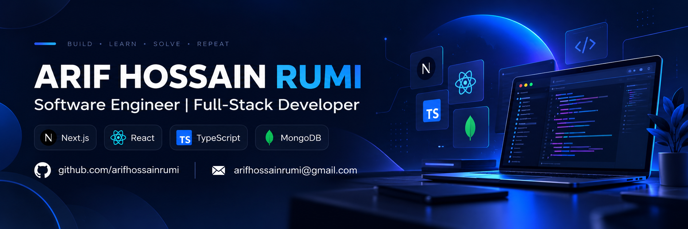

  

<h1 align="center">Hi, I'm Md. Arif Hossain Rumi 👋</h1>

  <strong>Software Engineer | Full-Stack Developer</strong> 
  Based in Bangladesh · Building reliable, practical web applications

  <a href="https://arifhossainrumi.com">Portfolio</a> ·
  <a href="https://www.linkedin.com/in/arifhossainrumi/">LinkedIn</a> ·
  <a href="mailto:arifhossainrumi@gmail.com">Email</a>

---

## About me

I'm a software engineer working mainly with **Next.js, React, TypeScript, and MongoDB**. I enjoy the full process of building software: shaping the interface, designing server-side logic, working with data, and making sure things keep running after deployment.

My current hands-on work includes **NestaMart**, a live e-commerce platform I built and maintain, and **Clydria**, a website project in active development. I also have a background in data analysis, which helps me think about products from both an engineering and business perspective.

- **Focus:** Full-stack web development, maintainable architecture, performance, and application security
- **Currently working on:** E-commerce workflows, reusable UI components, and responsive web experiences
- **Education:** B.Sc. in Computer Science & Engineering, University of Liberal Arts Bangladesh (ULAB), Fall 2022

## Tech stack

**Frontend**

**Backend, data & infrastructure**

**Tools & previous data work**

## Featured work

### [NestaMart — Full-Stack E-commerce Platform](https://nestamart.com) · Live

A custom e-commerce platform for customers in Bangladesh, built with **Next.js, React, TypeScript, MongoDB, and Mongoose**.

- Developed the storefront, product discovery, cart, checkout, order management, and inventory workflows.
- Built server-side business logic, customer authentication, and role-based access for administrative features.
- Worked on API security, SEO, analytics, deployment, and day-to-day maintenance.
- Organized the application around separated feature and business responsibilities within a modular full-stack architecture.

**Stack:** Next.js · React · TypeScript · MongoDB · Mongoose · Auth.js · Vercel · Cloudflare

### Clydria — Digital Studio Website · In development

Building a responsive website with an emphasis on typography, interaction, reusable components, and clear service presentation.

- Implementing the frontend with **Next.js, TypeScript, Tailwind CSS, and shadcn/ui**.
- Documenting engineering decisions and feature boundaries before expanding the application.
- Refining desktop and mobile experiences with accessibility and performance in mind.

**Status:** Active development; not presented as a completed client project.

### [Dhaka House Rent Prediction](https://github.com/arifhossainrumi/House_price_Prediction) · ML + Web Application

Built a rental-price prediction project combining **Python and scikit-learn** for modeling, a **Flask API** for predictions, and a **Flutter Web** interface.

## Earlier data analytics projects

Before focusing on full-stack engineering, I worked on analytics and visualization projects using Python, SQL, and Power BI.

- **[Dhaka Ride-Hailing Analysis](https://github.com/arifhossainrumi/Dhaka-Ride-Hailing-Analysis)** — Analyzed a *simulated* dataset of 15,000+ ride records, using Python, SQL, and Power BI to explore revenue patterns and traffic conditions.
- **[Customer Shopping Behavior Analysis](https://github.com/arifhossainrumi/Customer-Shopping-Behavior-Analysis)** — Explored 3,900 retail transactions, built customer segments and a predictive model, and presented findings in Power BI.

[See my earlier analytics project portfolio →](./PROJECTS.md)

## Learning & certifications

- IBM Python for Data Science
- Microsoft Power BI Data Analyst
- [Excel Basics for Data Analysis](https://coursera.org/share/aac24f009098e95bbda0f8a2bc5541aa)

## Get in touch

I enjoy connecting with developers, designers, and people working on useful digital products.

- **LinkedIn:** [arifhossainrumi](https://www.linkedin.com/in/arifhossainrumi/)
- **Portfolio:** [arifhossainrumi.com](https://arifhossainrumi.com)
- **Email:** [arifhossainrumi@gmail.com](mailto:arifhossainrumi@gmail.com)

---

  Building thoughtfully, learning continuously.

