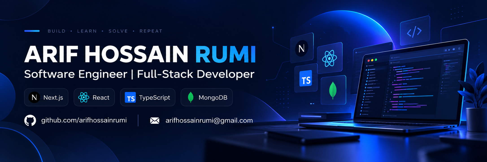

  

<h1 align="center">Hi, I'm Md. Arif Hossain Rumi 👋</h1>

  <strong>Software Engineer | Full-Stack Developer | Product Builder</strong> 
  Based in Bangladesh · Building practical, reliable software for real-world needs

  <a href="https://arifhossainrumi.com">Portfolio</a> ·
  <a href="https://www.linkedin.com/in/arifhossainrumi/">LinkedIn</a> ·
  <a href="mailto:arifhossainrumi@gmail.com">Email</a>

---

## About me

I'm a software engineer who enjoys building products end to end—from interfaces and backend logic to data models, security, deployment, and ongoing improvements. My main focus is **Next.js, React, TypeScript, and full-stack web engineering**.

I build and maintain **NestaMart**, a live e-commerce business, while developing **Amar Shanchay**, a modular finance and business platform, and **Clydria**, my digital design and engineering studio. I also explore game development and bring an earlier background in data analysis and machine learning to my work.

- **Focus:** Full-stack product engineering, maintainable architecture, performance, security, and useful user experiences
- **Currently building:** E-commerce systems, financial workflows, studio experiences, and a self-managed portfolio
- **Education:** B.Sc. in Computer Science & Engineering, University of Liberal Arts Bangladesh (ULAB), Fall 2022

## Tech stack

**Frontend**

**Backend, data & infrastructure**

**Tools, games & previous data work**

## Featured work

### [NestaMart — Full-Stack E-commerce Platform](https://nestamart.com) · Live

A custom e-commerce platform serving customers in Bangladesh, built and maintained as an ongoing product and business.

- Developed product discovery, checkout, order handling, inventory, and administrative workflows.
- Built authentication, role-based permissions, integrations with delivery operations, and server-side business logic.
- Worked across SEO, analytics, application security, performance, deployment, and maintenance.

**Stack:** Next.js · React · TypeScript · MongoDB · Mongoose · Auth.js · Vercel · Cloudflare

### Amar Shanchay — Financial & Business Operating System · In development

A multi-workspace platform for personal finance, shared living, and small-business operations.

- Built personal finance features for transactions, budgets, savings, liabilities, investments, and reports.
- Developed shared-living workflows for meals, market expenses, member management, and settlements.
- Expanded the business workspace toward inventory, sales, accounting, and modular industry-specific workflows.

**Stack:** React · TypeScript · Firebase / Firestore · Tailwind CSS

**Source:** Private repository; public description only.

### Clydria — Digital Design & Engineering Studio · In development

Building a digital studio and its web presence around thoughtful websites, e-commerce experiences, and custom web applications.

- Developing a responsive site with clear service presentation, reusable components, and refined typography.
- Organizing work around documented architecture, engineering decisions, and maintainable feature boundaries.
- Refining interaction, accessibility, and responsive behavior before launch.

**Stack:** Next.js · React · TypeScript · Tailwind CSS

**Source:** Private repository; studio/site is not presented as a completed client project.

## Other software projects

- **The Lost Atlas — 2D Puzzle Adventure (Prototype)** — An Android-first Godot project with touch-based exploration, clue collection, an evidence-driven symbol puzzle, and contextual hints. *Godot · GDScript · Private source.*
- **Personal Portfolio V2 — Self-managed Portfolio (In development)** — A new Next.js portfolio with service pages, SEO and accessibility foundations, automated quality checks, and a carefully gated database foundation. Admin/CMS and deployment work remain in progress. *Next.js · TypeScript · PostgreSQL / Neon · Drizzle · Private source.*

## Data analytics & machine learning

Earlier projects that shaped how I work with product data, experimentation, and business questions:

- **[Dhaka House Rent Prediction](https://github.com/arifhossainrumi/House_price_Prediction)** — Rental-price modeling with Python and scikit-learn, a Flask prediction API, and a Flutter Web interface.
- **[Dhaka Ride-Hailing Analysis](https://github.com/arifhossainrumi/Dhaka-Ride-Hailing-Analysis)** — Python, SQL, and Power BI analysis of a **simulated** dataset of 15,000+ rides.
- **[Customer Shopping Behavior Analysis](https://github.com/arifhossainrumi/Customer-Shopping-Behavior-Analysis)** — Analysis and customer segmentation using 3,900 retail transactions, predictive modeling, and Power BI.
- **[E-commerce Sales Analysis](https://github.com/arifhossainrumi/E-commerce-Sales-Analysis)** — Exploratory sales analysis, operational trends, and forecasting with Python.

**[Explore the full curated project catalog →](./PROJECTS.md)**

> Some active projects use private repositories. Their summaries describe the product and my work without exposing source code or confidential implementation details.

## Learning & certifications

- IBM Python for Data Science
- Microsoft Power BI Data Analyst
- [Excel Basics for Data Analysis](https://coursera.org/share/aac24f009098e95bbda0f8a2bc5541aa)

## Get in touch

I enjoy connecting with developers, designers, and people building useful digital products.

- **LinkedIn:** [arifhossainrumi](https://www.linkedin.com/in/arifhossainrumi/)
- **Portfolio:** [arifhossainrumi.com](https://arifhossainrumi.com)
- **Email:** [arifhossainrumi@gmail.com](mailto:arifhossainrumi@gmail.com)

---

  Building thoughtfully, learning continuously.

